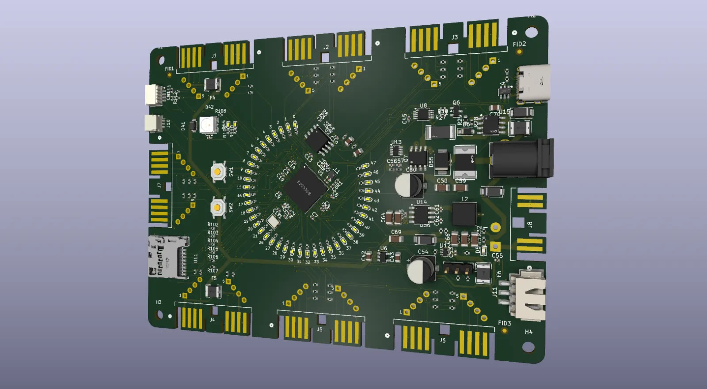
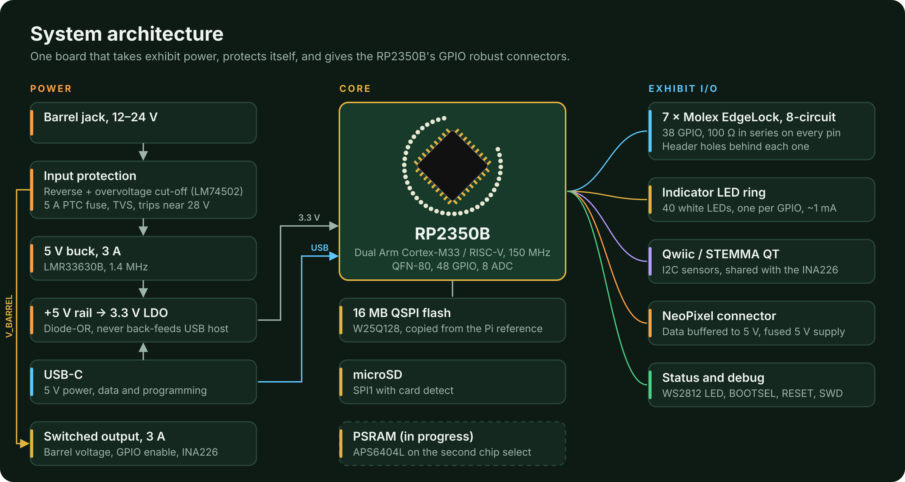
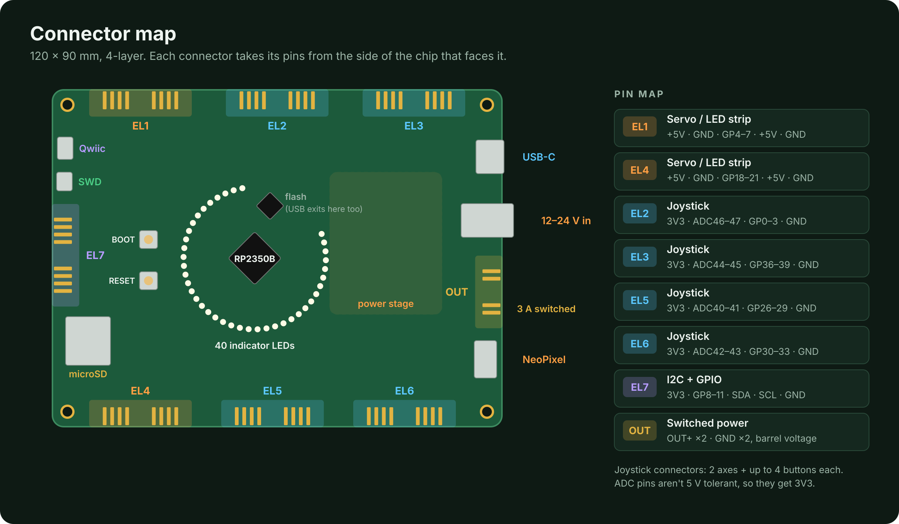
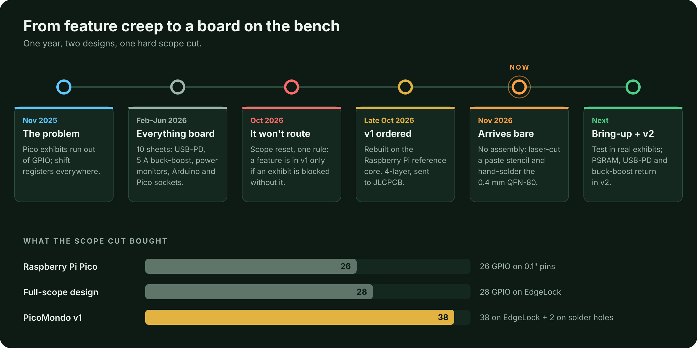
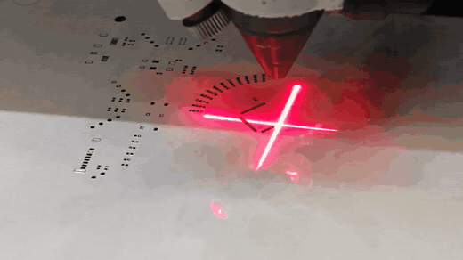
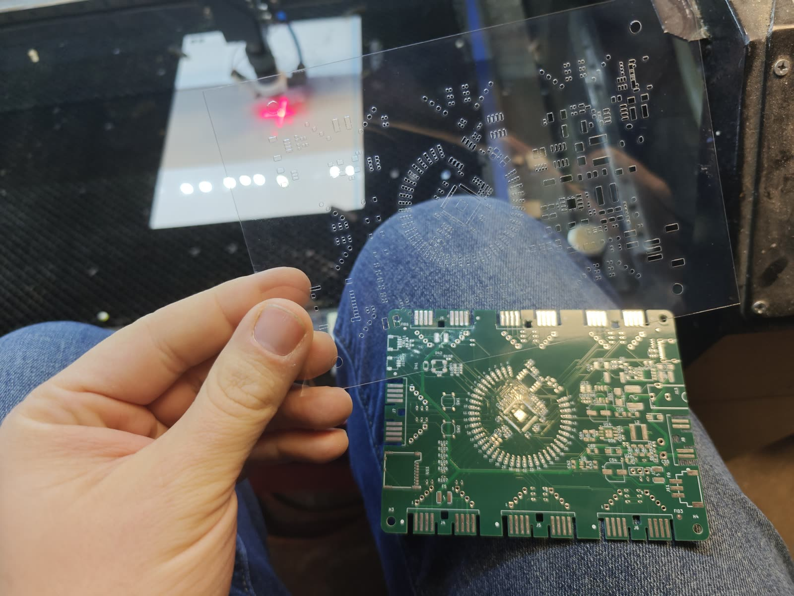
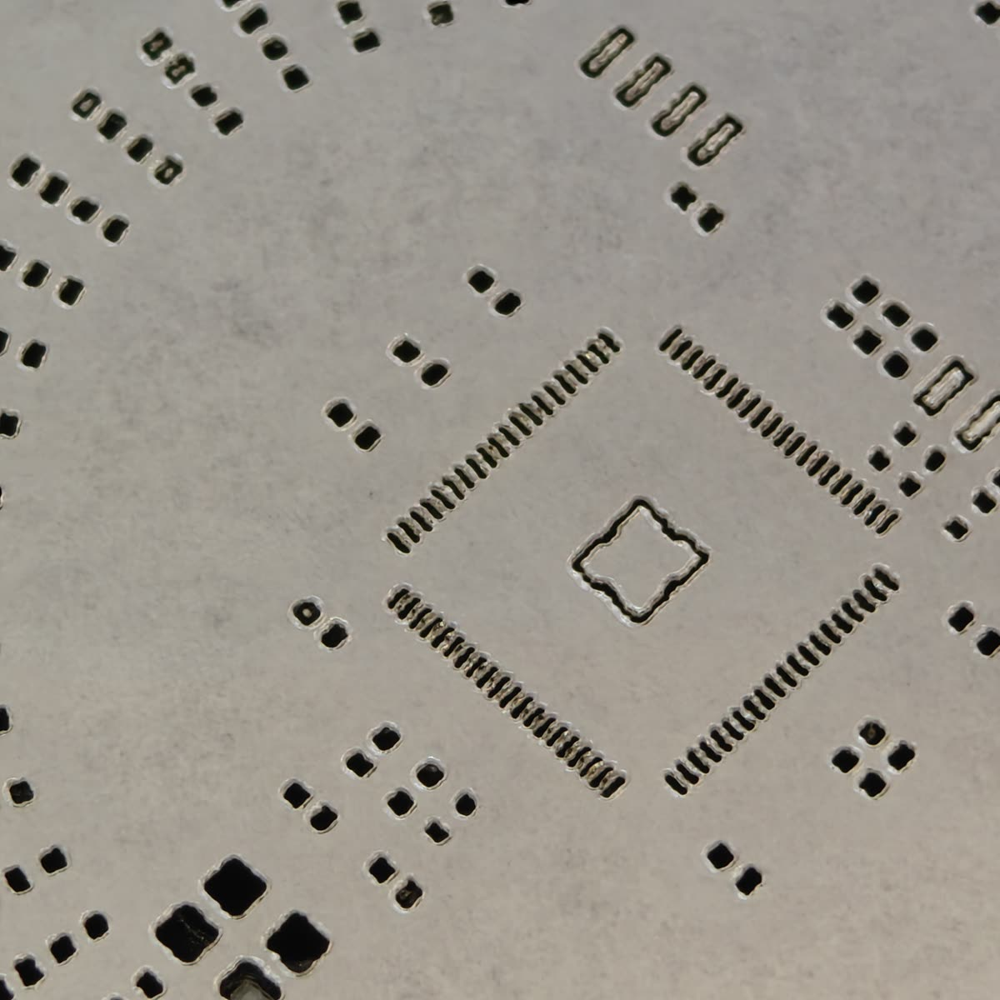

# PicoMondo

**An RP2350B exhibit controller for Clark Planetarium: 38 protected GPIO on locking board-edge connectors, an indicator LED on every pin, and real exhibit power on board.**

> This is by far the most advanced board I've designed, and I used AI heavily throughout the process. See [How I worked](#how-i-worked).

## What I was trying to do

Our museum exhibits run on Raspberry Pi Picos, and the bigger ones kept running out of pins. Exhibits with a lot of buttons needed shift registers just to read them all. I wanted one board we could drop into any exhibit, with:

- **More GPIO on connectors that survive an exhibit.** Molex EdgeLock crimp housings clip straight onto the edge of the PCB, so a wiring harness plugs in without a header to snap off. There are seven 8-circuit connectors (38 GPIO), each with a 100 Ω series resistor on every signal, and four of them are set up for joysticks (two ADC pins plus 3V3).
- **Debugging you can see from across the room.** A ring of 40 indicator LEDs around the chip, one per GPIO, laid out in pin order, so a stuck button or a dead output is obvious at a glance, without a laptop.
- **Real exhibit power.** A 12–24 V barrel input with reverse-polarity and overvoltage cut-off feeds a 3 A 5 V buck and a GPIO-switched 3 A output for solenoids and 12 V loads, with a current monitor so firmware can catch stalls. USB-C still works for programming and bench power.
- **Hard to damage, easy to build on.** Fused 5 V connectors for servos and LED strips, a buffered NeoPixel output, Qwiic for I2C sensors, microSD, SWD, and header holes behind every connector for prototyping.

We build about 20 a year for our own exhibits and other science museums, and I'm releasing the design as open source.

## How it works

The RP2350B core is copied directly from Raspberry Pi's reference layout and rotated 45° as one block. Each connector takes its pins from the side of the chip nearest it, and the LED ring leaves a gap where the flash and USB leave the chip.

A few details I'm happy with:
- The switched output uses a **4-circuit EdgeLock with the contacts paralleled 2 + 2**, because Molex rates each contact at 3 A. Paralleling halves the current per contact.
- The board finish is **lead-free HASL instead of ENIG**: the EdgeLock contacts are tin, and Molex's spec warns against tin-on-gold mating.
- The indicator LEDs are **white on purpose**. Their ~2.4 V forward voltage means they don't pull weak-pull-up inputs low; amber LEDs would have dragged inputs near the logic threshold.
- The input protection (LM74502 with back-to-back FETs) **cuts off near 28 V** instead of relying on a TVS, so a 36 V or 48 V supply plugged in by mistake is simply disconnected instead of destroying the board.

## How it went

The first design tried to do everything: USB-PD, a 5 A buck-boost, two monitored outputs, three power inputs, and Arduino and Pico sockets in the middle. It reached a 10-sheet schematic and then would not route. I restarted with one rule: **a feature goes in v1 only if a real exhibit would be blocked without it.** That freed the centre of the board (where the sockets had been) for the LED ring and still raised the connector count from 28 GPIO to 38. The full-scope design is kept in [`hardware/archive/v0-full-scope`](hardware/archive/v0-full-scope) as the starting point for v2.

## Building it

v1 went to JLCPCB in late October 2026. Because of problems with the order, the boards arrived bare instead of assembled, so I'm building them by hand. I exported the solder paste layer from KiCad and laser-cut my own Mylar stencil, including the 0.4 mm pitch apertures for the 80-pin QFN.

*Laser-cutting the stencil, sped up 4×. [Full video (43 s)](docs/media/stencil_laser_cut.mp4).*

<!-- To get an inline video player on GitHub: edit this README on github.com, drag docs/media/stencil_laser_cut.mp4 into the editor, and replace the GIF line above with the link GitHub generates. -->

| The finished stencil over a bare board | QFN-80 apertures at 0.4 mm pitch |
|---|---|
|  |  |

Assembly uses an interactive BOM with part-sorting boxes added to the board file (`hardware/archive/v1-as-ordered/hand-assembly`).

## How I worked

I had never designed a board this advanced before: four layers, a fine-pitch QFN-80, a switching regulator, input protection and 40-odd connectors' worth of routing. I used AI (Claude) heavily the whole way through, as a collaborator and a tutor:

- turning my requirements into a written spec, and keeping a log of decisions and why they were made
- reading datasheets and Raspberry Pi's hardware design guide with me, and checking values against them (crystal load capacitors, the 16 MB flash limit, regulator layout)
- picking parts and matching them to JLCPCB stock
- writing the Python scripts that generated schematic sheets, placed parts and built the BOM and pick-and-place files

I set the goals and the scope, made the final calls, worked the design through in KiCad, dealt with JLCPCB on the order and part substitutions, and I'm cutting the stencil and assembling the boards myself.

## Status

- **v1:** bare boards in hand, stencil cut, hand assembly in progress. Bring-up and exhibit testing are next.
- **Working copy:** adding optional PSRAM on the second QSPI chip select (paused).
- **v2 candidates:** USB-PD, buck-boost, a second switched output, polarity-agnostic input, a "maker" variant with Arduino/Pico sockets.

Tools: KiCad 10, Freerouting, Python scripts for KiCad file generation and placement, JLCPCB, a laser cutter for the stencil.

---

## Repository layout

| Path | What it is |
|---|---|
| `hardware/picomondo/` | **The working KiCad project.** v1 plus an in-progress addition (see its README). |
| `hardware/archive/v1-as-ordered/` | Frozen copy of v1 exactly as sent to JLCPCB in October 2026, with the order files. Use it to build and troubleshoot those boards. |
| `hardware/archive/v0-full-scope/` | The earlier full-feature design (USB-PD, TPS55288 buck-boost, Arduino/Pico sockets). Abandoned because it would not route, but its sheets and design notes are the starting point for v2 features. |
| `hardware/route-art/` | Decorative "route art" silkscreen experiments. |
| `docs/specs/` | Current spec, plus the superseded specs that came before it. |
| `docs/history/` | Build notes and background from earlier stages. |
| `docs/media/` | Photos, video and the README graphics (`src/` has the SVG sources and the script that makes them). |
| `firmware/` | Placeholder. |

## Opening the project

Open `hardware/picomondo/picomondo_reduced.kicad_pro` in KiCad 10. All project libraries (symbols, footprints and most 3D models) live in `lib/` and `JLCImport.*` and are referenced through `${KIPRJMOD}`, so nothing needs installing. The KiCad project still carries the `picomondo_reduced` name from development; renaming it inside KiCad is safe, but renaming the files by hand would break the schematic annotations.

## Full specification

[`docs/specs/PicoMondo_v1_Specification.md`](docs/specs/PicoMondo_v1_Specification.md)

## License

MIT, see [`LICENSE`](LICENSE).
